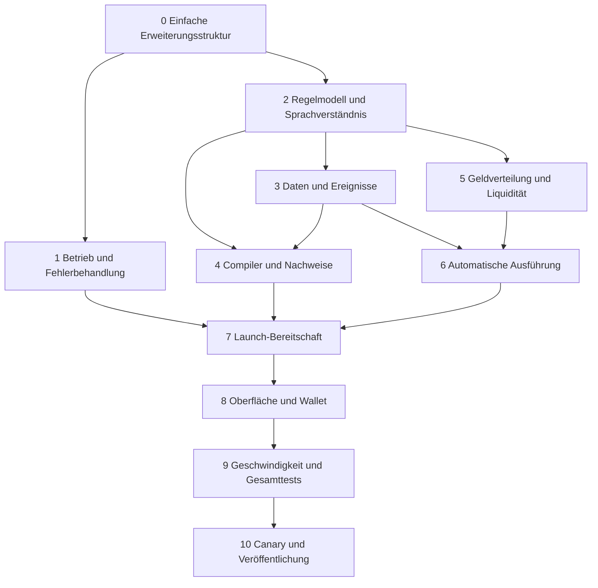

# Custom AI Composable Launch Implementation Plan

> **For agentic workers:** REQUIRED SUB-SKILL: Use superpowers:subagent-driven-development or superpowers:executing-plans to implement this plan task-by-task. Steps use checkbox syntax for tracking. Existing user authorization and repository rules take precedence; this document is a plan, not an instruction to spend or deploy now.

**Goal:** Ein Nutzer beschreibt kombinierte Gebühren-, Zeit-, Ereignis- und Geldflussregeln und erhält einen vollständig vorbereiteten Launch mit einer verständlichen Zusammenfassung und einer primären Aktion. Das Team kann AI-Verhalten, Werkzeuge, APIs und Regelbausteine anschließend mit kleinen, gezielt geprüften Änderungen erweitern.

**Architecture:** Ein gemeinsamer Fähigkeitskatalog und eine getrennte AI-Konfiguration speisen den bestehenden Chat-Ablauf. Die AI erzeugt eine versionierte Regelbeschreibung; ein deterministischer Compiler, ein unabhängiger Referenzrechner und geprüfte Finanzverträge setzen sie gemeinsam um. Serverseitige Vorbereitung und dauerhafte Hintergrunddienste liefern einen einzigen wahrheitsgemäßen Bereitschaftsstatus.

**Tech Stack:** Bestehendes Next.js/React/TypeScript, Anthropic, Postgres/PGlite, viem, Solidity 0.8.26, Uniswap v4, Foundry und die vorhandene isolierte EVM-Toolchain.

**Spec:** [Zielbild und Abnahmeregeln](../specs/2026-10-23-custom-ai-composable-launch-design.md)

Grundlage: `b28841a873b31a815cfd13e4d139af013b272d95`. Die Aufgaben sind vorgeschlagene Implementierungsentscheidungen. Produktcode wird durch diesen Plan nicht verändert.

## Global Constraints

- 1.000.000.000 Token, 18 Dezimalstellen, kein späteres Minting, kein Burn, keine Blacklist, kein Pause-Schalter und keine Transfersteuer.
- Gesamtgebühren von mindestens 0,5 % und höchstens 15 %; die feste Plattformkomponente beträgt 0,5 %.
- Start-FDV gemäß bestehendem Core: 15.000 USD, einschließlich vorhandener Tick-Rundungsgrenze bis 15.091,50 USD.
- Die Startliquidität bleibt dauerhaft gesperrt. Neue Zusatzpositionen werden ebenfalls dauerhaft gesperrt.
- Ethereum (1) und Robinhood (4663) werden separat geprüft.
- Bestehende Coins und aktive Wallet-Journale bleiben mit ihren ursprünglichen Vertragsversionen lesbar und wiederaufnehmbar.
- Kein Ausfall einer Geldaktion oder eines Keepers darf den normalen Verkauf blockieren.
- Kein technischer Pflicht-Check im Nutzerablauf; die finale Launch-Handlung bestätigt genau die sichtbare Revision.
- Keine stillen Änderungen von Gebühren, Verteilung, Empfängern, Datenquelle oder Preisrisiko.
- Vorgeschlagene Leistungskriterien: UI p95 <300 ms; inhaltliche Antwort p95 <3 s; vollständiger Standardentwurf p95 <15 s warm / <30 s kalt. Nutzerantwort, Signatur und Finalität separat messen.
- Bestehende Feature-Arbeit bleibt in einem isolierten Worktree. Vor Ausführung Basis/Head, fremde Änderungen und aktuelle PR-CI prüfen.
- Finanzierte Versuche, Diensteinkauf und Veröffentlichung werden erst anhand konkreter Betreiberbudgets und der bestehenden Freigaben ausgeführt.
- Neue Fähigkeiten innerhalb der vorhandenen Arten werden in einem eigenen Ordner und einem Registrierungseintrag ergänzt. Orchestrierung, Launch-UI und Verträge werden dafür nicht routinemäßig geändert.
- Kleine AI-/Recherche-Updates verwenden gezielte automatische Prüfungen; die Erstabnahme neuer Finanzlogik wird nicht pauschal wiederholt. Der bestehende CI-/Veröffentlichungsweg bleibt der einzige Weg.
- Versionen werden pro Auftrag gebunden. Abschalten einer Erweiterung für neue Arbeit darf laufende Wallet-Journale oder die Datenversorgung veröffentlichter Coins nicht still verändern.

## Review Focus

1. Gleichzeitige Textänderung, zweiter Browser-Tab oder Netzwerkwechsel: keine alte Konfiguration unterschreiben. Tests in Aufgaben 2, 7 und 8.
2. Wetterwerte kommen doppelt, verspätet, in falschen Einheiten oder nach einer Reorganisation: kein falscher Übergang und keine doppelte Geldaktion. Tests in Aufgaben 3 und 6.
3. Gefälschte, manipulierte oder zu alte Preisreferenz und minimale Beträge: keine unbeschränkte Wiederanlage oder verlorenes Restgeld. Tests in Aufgabe 5.
4. Provider bestätigt keine Antwort oder der Stream endet nach HTTP 200: gespeicherten Auftrag korrekt wiederaufnehmen, keine doppelte Nutzerbelastung. Tests in Aufgabe 1.
5. Neue Programmversion trifft auf alte Coins und laufende Wallet-Journale: historische Bindungen erhalten. Tests in Aufgaben 4, 7, 8 und 10.

Zusätzlicher Strukturtest in Aufgabe 0: Ein neuer Recherchebaustein wird automatisch im Planer nutzbar, ohne eine zweite Funktionsliste oder Vertragsänderung. Der CI-Plan erkennt trotzdem Eingriffe in gemeinsam benutzte Ausführung oder Berechtigungen.

## Gemeinsame Schnittstellen

Aufgabe 0 legt Fähigkeitsverträge und Versionsbindung fest; Aufgabe 2 ergänzt diese Typen in `lib/custom-ai/rule-spec.ts`. Erweiterungen innerhalb vorhandener Arten verändern deren zentrale Hülle nicht:

- `RuleSpecV2`: `version:2`, vollständige Gebührenphasen, typisierte Bedingungen, Feed-Anforderungen, Aktions-/Gebührenanteile und Zuordnung jeder Regel zur Nutzeranforderung.
- `RuleContext`: vergangene Sekunden, Kauf/Verkauf und geprüfte `FeedSnapshot[]`.
- `RuleDecision`: Gesamtgebühr, aktive Phase, benötigte Quellen, freigegebene Aktionen und deren Ereignis-ID.
- `BoundRuleSpec`: normalisierte Spezifikation plus Netzwerk, Quote-Asset, konkrete Feed-Bindungen und Programmversionen.
- `RuleEvidence`: Intent-Abdeckung, Grenzwertfälle, Referenz-/EVM-Vergleich, Source-/Konfigurations-/Bundle-Hashes und Lebenszyklus-Ergebnis.
- `CompiledRuleBundle`: `specHash`, `sourceHash`, `artifactHash`, `coreBundleHash`, ausführbare Artefakte und Programmplan; enthält noch keine Behauptung einer erfolgreichen Prüfung.
- `CheckedRuleBundle`: `CompiledRuleBundle` plus vollständig bestandene `RuleEvidence`.
- `FeedSnapshot`: `feedId`, `sequence`, `transitionSequence`, `value`, `previousValue`, `changedAt`, `observedAt`, `validUntil`, `sourceVersion`, `fresh`. `sequence` zählt akzeptierte Beobachtungen, `transitionSequence` nur echte Wertänderungen. Ereignis-IDs binden Feed-Identität und `transitionSequence`.
- `OperationalSnapshot`: Netzwerk-/Deployment-Version, Daten- und Worker-Gesundheit, Prüfzeit, Gültigkeitsende und maschinenlesbare Blocker.
- `LaunchPreparation`: Zustand, Revisions-/Konfigurationshash, Ablaufzeit, sichtbare Zusammenfassung, Wallet-Schritte und optionale `readyTicket`.

Weitere Typen werden in ihrer jeweiligen Aufgabe definiert: `FeedBinding` bindet Chain, Adresse, Code-Hash, Quellenversion, Einheit und Frischegrenze; `WeatherFeedDefinition` bindet Anbieter, Koordinaten, Messgröße, Skalierung und Datenart. `ProgramDeploymentPlan` enthält versionierte Konfiguration, vorhergesagte Adressen, Code-Hashes und geordnete Deployment-Aufrufe. `LaunchInputs` enthält Owner, aktuelle Revision, `CoinSettings`, Account und Chain; `PreparedLaunch` ergänzt die daraus geprüfte `LaunchOrder` um Ticket und geordnete Wallet-Schritte. Die vorhandenen Typen `ChatRequest`, `CoinSettings`, `LaunchOrder`, `Address` und `Hex` werden importiert, nicht parallel neu erfunden. `WalletAdapter` kapselt Account, Chain, Capability-Abfrage, Senden und Statusabfrage; `WalletSubmission` bindet in beiden Varianten dieselbe Session-ID und Revision.

Anfangsgrenzen des Compilers sind interne, getestete Vorschläge: höchstens 32 Regelknoten, Tiefe 8, vier Feed-Bindungen und vier Aktionsziele. Vier gebundene Feeds bedeuten nicht vier garantierte externe Leseaufrufe auf jedem Ausführungspfad. Jeder tatsächlich mögliche Pfad muss inklusive Kaltzugriffen, Rückgabedaten und Bedingungen in das vorhandene 100.000-Gas-Limit passen. Überschreitungen erzeugen eine gezielte fehlende-Fähigkeit-Antwort; Regeln dürfen nicht abgeschnitten und Lesegrenzen nicht ungeprüft erhöht werden.

## Reihenfolge und Zusammenführung

Aufgabe 0 wird als gemeinsame Grundlage zuerst umgesetzt. Ab Aufgabe 2 können Daten, Compiler und Finanzverträge getrennt bearbeitet werden. Schnittstellen und geteilte Dateien haben jeweils einen Integrationsverantwortlichen. Jede Aufgabe endet mit einem eigenen überprüfbaren Commit. Die umfangreiche Erstfreigabe in Aufgabe 10 gilt für diesen neuen Finanzpfad; spätere Änderungen verwenden den unten beschriebenen betroffenen Prüfbereich.

Dateilisten verwenden für weitere Dateinamen derselben Gruppe das zuletzt genannte Verzeichnis. Bei den reinen Dateinamen in Aufgaben 2, 4 und 7 ist das Verzeichnis `lib/custom-ai/`.

## Aufgabe 0: Fähigkeiten einfach ergänzen und gezielt veröffentlichen

**Files**
- Create: `lib/custom-ai/capabilities/types.ts`, `registry.server.ts`, `dispatch.server.ts`; `lib/custom-ai/ai-config.ts`.
- Create initial modules: `lib/custom-ai/capabilities/catalog-search/index.server.ts`, `web-search/index.server.ts`, `contract-read/index.server.ts`.
- Create examples: `tests/fixtures/custom-ai/capabilities/search-hooks.ts`, `tests/fixtures/custom-ai/intent-regressions.json`.
- Modify: `lib/custom-ai/service.server.ts`, `prompt.ts`, `rules.ts`, `knowledge.ts`, `knowledge.server.ts`, `claude.server.ts`, `store.server.ts`, `types.ts`; `scripts/ci/interface-plan.mjs`, `scripts/ci/interface-plan.test.mjs`.
- Create: `docs/custom-ai/ADDING-A-CAPABILITY.md`, `tests/custom-ai-capabilities.test.ts`, `tests/custom-ai-ai-config.test.ts`.

**Interfaces**
- `CapabilityKind = "tool" | "feed" | "rule" | "action"`; `CapabilityRef = { id:string; version:string; implementationHash:string }`.
- `CapabilityDefinition` ist eine diskriminierte Union mit `ref`, `kind`, `description`, Ein-/Ausgabeschema und versionierten `dependencies`. Die einzelnen Arten liefern typisierte Adapter; ein Recherche-Tool erhält nur lesende Zugriffe und keine Wallet-/Signer-Schnittstelle. Regel-/Aktionsadapter integrieren die in Aufgaben 2 bis 5 definierten Schnittstellen, ohne diese in Aufgabe 0 vorweg zu implementieren.
- `CapabilityContext` enthält Owner, Netzwerk, Abbruchsignal und begrenztes Auftragsbudget. Zugangsdaten werden nur serverseitig im zuständigen Adapter aufgelöst, niemals als Modellargument.
- `getCapabilities(context:CapabilityContext):Promise<CapabilityDefinition[]>` filtert statisch registrierte Implementierungen anhand erlaubter Nutzung, Netzwerk und Konfiguration. Beschreibungen/Schemata für den Planer und öffentliche Metadaten entstehen durch explizite Projektionen; Serverfunktionen und Secrets gelangen nicht in den Browser.
- `dispatchTool(ref:CapabilityRef,input:unknown,context:CapabilityContext):Promise<KnowledgeResult>` validiert Schema, aktuelle Berechtigung und Ausgabe und kapselt Timeout/Fehler. Vorhandenes `KnowledgeResult` verwenden; keinen universellen Vertragsexecutor einführen.
- `AIConfig` enthält ID, Version, Modellzuordnung, Antwortstil und Planungsanweisungen. `ExecutionProfile` bindet `aiConfigId`, `aiConfigVersion` und `CapabilityRef[]` pro dauerhaftem Auftrag. Aktions-/Regelversionen fließen in `BoundRuleSpec` und dessen Hash ein; reine Rechercheversionen in die Herkunft des Auftrags, ohne bestehende Vertragsartefakte unnötig ungültig zu machen.

- [ ] Tests definieren: registriertes Tool erscheint im Planerschema und wird über dieselbe Dispatch-Funktion aufgerufen; unbekannte Version, ungültige Eingabe und fehlende Berechtigung werden abgewiesen. Ausfall einer optionalen Such-API blockiert keinen davon unabhängigen Entwurf.
- [ ] Bestehende Katalogsuche, Webrecherche und Vertragsabfrage ohne Funktionsverlust in die kleinen Adapter überführen. Prompt-/Schema-Aufbau aus dem Katalog ableiten; individuelle `if`-/`switch`-Verzweigungen pro Werkzeug aus `service.server.ts` entfernen. Auswahl einer begrenzten relevanten Werkzeugmenge statt aller Beschreibungen bei jedem Auftrag.
- [ ] Modellzuordnung und veränderliche AI-Anweisungen nach `ai-config.ts` verschieben. Feste Produktgrenzen bleiben im ausführenden Regel-/Vertragskern; eine Konfigurationsänderung kann sie nicht aufheben.
- [ ] `ExecutionProfile` zusammen mit dem Auftrag speichern. Ein Konfigurationswechsel wirkt auf neue Aufträge. Alte Aufträge verwenden ihre gespeicherte Version; eine nicht mehr verfügbare Implementierung erzeugt einen ausdrücklichen Wiederaufnahmegrund, keine stille Migration. Neue Regel-/Aktionsversionen ändern keine bestehenden Coins.
- [ ] Strukturbeweis: In einem isolierten Testregister `search_hooks` mit festem Hook-Katalog hinzufügen. Tests fordern Registrierung, Werkzeugauswahl, Quellen und verständliche Fehlermeldung, ohne Änderungen an zentralem Ablauf, Wallet, UI oder Verträgen. Danach den normalen Erweiterungsweg als Modulordner plus Registrierungseintrag dokumentieren.
- [ ] Bestehenden CI-Plan um die Fähigkeits-/Abhängigkeitsstruktur ergänzen. Eine reine lesende Erweiterung erhält Adapter-/Chat-Tests; Prompt-/Modelländerungen erhalten betroffene Intent-Beispiele. Gemeinsam genutzte HTTP-/Auth-, Compiler-, Wallet- oder Vertragsänderungen erweitern die Auswahl auf ihre echten Nutzer. Dateiumbenennung, Löschung, dynamische Abhängigkeit und Änderung am Klassifikator selbst dürfen benötigte Tests nicht ausblenden. Keine Freistellung allein aufgrund eines Manifestfelds.
- [ ] CI-Klassifikator mit zwei konkreten Diffs prüfen: neue Hook-Suche löst keine Finanz-Canarys aus; dieselbe Änderung zusammen mit `launch-plan.ts` löst die entsprechenden Wallet-/Bindungstests aus. Exakte schon bestandene Prüfungen wiederverwenden; keine zusätzliche manuelle Freigabekette für denselben Stand.
- [ ] Einen bereinigten Nutzerkorrekturfall in die Intent-Beispiele aufnehmen; erwartetes Verhalten unabhängig festlegen. Fehler-/Laufzeit-/Kostenbericht um Versionsangaben erweitern. Wechsel auf vorige AI-/Toolversion für neue Aufträge testen; Onchain-Version und laufende Versorgung unverändert erhalten.
- [ ] `npx vitest run tests/custom-ai-capabilities.test.ts tests/custom-ai-ai-config.test.ts` und `node --test scripts/ci/interface-plan.test.mjs` grün. Commit: `refactor(custom-ai): isolate capabilities and targeted update checks`.

**Done:** Ein weiterer Recherche-/API-Baustein und eine AI-Konfigurationsänderung lassen sich jeweils lokal ergänzen, gezielt prüfen und für neue Arbeit aktivieren. Kein neuer zentraler Sonderfall, kein Vertragsdeploy und kein allgemeines Plugin-Framework sind dafür erforderlich.

## Aufgabe 1: Provider-Ausfälle und Hintergrundaufträge korrekt behandeln

**Files**
- Create: `lib/custom-ai/provider-errors.ts`, `lib/custom-ai/provider-health.server.ts`, `lib/custom-ai/build-job.server.ts`.
- Modify: `claude.server.ts`, `store.server.ts`, `access.server.ts`, `service.server.ts`, `events.ts` unter `lib/custom-ai/`; `app/api/custom-ai/route.ts`, `app/api/custom-ai/usage/route.ts`.
- Test: `tests/custom-ai-provider-health.test.ts`, `tests/custom-ai-build-job.test.ts`, bestehende Store-/Recovery-Tests.

**Interfaces**
- Produces: `classifyProviderFailure(status:number, body:unknown): ProviderFailure`, mit `kind`, `retryable`, `requestId?`.
- Produces: `runBuildJob(owner:string, request:ChatRequest): Promise<BuildJob>` und `readBuildJob(owner:string,id:string):Promise<BuildJob>`; Abschluss wird vor Ergebniszustellung gespeichert.
- `BuildJob` enthält eine persistierte Phase, Eingaberevision, Ergebnis und genau einen finalen Abrechnungszustand.

- [ ] Fehlerfixtures für das beobachtete Guthabenproblem, 401, 429 mit/ohne Retry-After, 529 und Abbruch nach Stream-Start anlegen. Prüfen: dauerhafte Fehler werden nicht blind wiederholt; Timeout erzeugt keinen zweiten aktiven Auftrag.
- [ ] `npx vitest run tests/custom-ai-provider-health.test.ts tests/custom-ai-build-job.test.ts tests/custom-ai-store.test.ts tests/custom-ai-chat-recovery.test.ts` ausführen und die neue fehlende Behandlung nachweisen.
- [ ] Fehlerkörper begrenzt und ohne Secrets auswerten; Betriebsfehler von Nutzerlimit trennen. Einen serverseitigen Circuit Breaker, Alarmdaten und Wiederanlaufpfad ergänzen.
- [ ] Aufträge vom Browser-Stream entkoppeln: Schließen des Tabs beendet die Ergebniszustellung, nicht unbemerkt den dauerhaften Auftrag. Expliziten Abbruch getrennt behandeln. Eine bestätigte Infrastrukturstörung gibt Nutzerkontingent exakt einmal frei; Provider-Kosten-/Missbrauchszähler bleiben separat.
- [ ] Dieselben Tests einschließlich doppeltem Abschluss, falscher Lease und zwei Browsern grün ausführen. Commit: `fix(custom-ai): preserve jobs and classify provider failures`.

**Done:** Der bekannte Guthabenfehler ist verständlich und betrieblich sichtbar; kein kaputter Neuversuchszyklus und kein verlorener Entwurf.

## Aufgabe 2: Eine vollständige, kombinierbare Regelbeschreibung

**Files**
- Create: `lib/custom-ai/rule-spec.ts`, `rule-evaluator.ts`, `intent-coverage.server.ts`.
- Modify: `rules.ts`, `prompt.ts`, `service.server.ts`, `types.ts`, `studio.ts`, `studio-sync.ts`.
- Test: `tests/custom-ai-rule-spec.test.ts`, `tests/custom-ai-intent-coverage.test.ts`; Create `tests/fixtures/custom-ai/london-liquidity-v2.json`.

**Interfaces**
- Produces: `normalizeRuleSpec(input:unknown):RuleSpecV2`, `evaluateRuleSpec(spec:RuleSpecV2,context:RuleContext):RuleDecision`.
- Produces: `verifyIntentCoverage(request:ChatRequest,previous:RuleSpecV2|undefined,next:RuleSpecV2):Promise<IntentCoverage>`.
- `IntentCoverage` enthält jeden angeforderten Teil als `covered`, `needs-input` oder `unsupported`; nur vollständiges `covered` darf weiterlaufen.

- [ ] Golden-Fixture aus der Spec anlegen: 1000/550/102/100/500/50 Basispunkte an den genannten Zeit-/Wetterpunkten. Separate Fälle für UND/ODER, Wiederholung, Zustandswechsel und mehrere Gebührensenken definieren.
- [ ] Neue Tests ausführen; fehlende Kombination und nicht erhaltene Teilregel müssen sichtbar scheitern.
- [ ] Planer auf vollständige Spezifikation mit Herkunft jeder Regel umstellen. Prioritäten, Rundung und Aktionsauslöser explizit normalisieren; überlappende Regeln ohne eindeutige Priorität zurückweisen.
- [ ] Unveränderte Regeln beim Edit erhalten; einen Verlust von Wetterbedingung, LP-Ziel oder Gebührenanteil als unvollständige Änderung erkennen. Materielle Unklarheiten in einer fokussierten Nutzerfrage bündeln.
- [ ] Referenzrechner ohne EVM-Code und ohne Compiler-Helfer implementieren. Gebühren auf Integer-Basis berechnen; eingehende Gleitkommawerte verbieten.
- [ ] Regelknoten binden `CapabilityRef` und gegen das registrierte Regelschema validierte Parameter. Die registrierten Regelarten liefern Planungshinweise und Zusammenfassung. Neue Bausteine benötigen keine zweite handgepflegte Liste in `prompt.ts`, `service.server.ts` oder der UI.
- [ ] Tests grün; Commit: `feat(custom-ai): normalize composable launch rules`.

**Done:** Derselbe Auftrag bleibt als vollständiges überprüfbares Objekt erhalten; das Modell kann keinen Teil unbemerkt durch etwas Einfacheres ersetzen.

## Aufgabe 3: Wetter und andere Ereignisse als reale Produktfähigkeit

**Files**
- Create: `lib/custom-ai/feed-adapters/weather.server.ts`, `feed-registry.server.ts`.
- Create: `contracts/src/custom-ai/CustomAIDataFeedV2.sol`, `contracts/test/custom-ai/CustomAIDataFeedV2.t.sol`.
- Modify: `lib/custom-ai/feed.ts`, `feed.server.ts`, `feed-update.server.ts`; `scripts/custom-ai/update-feed.mjs`, `export-program.mjs`.
- Test: `tests/custom-ai-weather-adapter.test.ts`, `tests/custom-ai-feed-v2.test.ts`.

**Interfaces**
- Consumes: `RuleSpecV2`, `FeedSnapshot`.
- Produces: `resolveRuleFeeds(spec:RuleSpecV2,chainId:1|4663):Promise<FeedBinding[]>`.
- Produces: `normalizeWeather(raw:unknown,definition:WeatherFeedDefinition):FeedSnapshot`.
- Contract: `latestSnapshot()` liefert die festgelegten numerischen Werte und Zeiten; signierte Updates binden Netzwerk, Vertrag, Quelle und Sequenz.

- [ ] Wiederholter Messwert, alter Zeitstempel, gleiche Zeit mit widersprüchlichem Wert, falsche Einheit, Sommerzeit und manipulierte Ortsauflösung testen. Gleichbleibender Wert erzeugt keinen neuen Übergang.
- [ ] London anhand fester Koordinaten/Einheiten und einer versionierten Anbieterdefinition integrieren. Credentials nur im Betreiberadapter halten; öffentliche Herkunfts-URL und authentifizierten Abruf-Endpunkt getrennt behandeln.
- [ ] Den Wetteradapter als Feed-Fähigkeit registrieren. Bestehende gemeinsame HTTP-Funktionen für Abbruch, Größenlimit und Fehler nutzen. Ein zusätzlicher Anbieter bekommt denselben Adaptervertrag und seine eigenen normalisierten Fixtures; sein tatsächlicher Anschluss wird vor Aktivierung mit einem begrenzten Provider-Abruf geprüft.
- [ ] V2-Feed mit vorherigem Wert, Änderungszeitpunkt und separater `transitionSequence` implementieren; diese Übergangsfelder aus akzeptierten Werten ableiten. Erneute Beobachtung desselben Wertes erhält dieselbe Übergangs-ID. Beliebige vom Reporter erfundene Übergangszeiten nicht ungeprüft übernehmen.
- [ ] Modell-, Prognose- und Beobachtungsdaten explizit kennzeichnen. Frische an originalem Quellzeitpunkt und vereinbartem Intervall prüfen, nicht am HTTP-Abruf. Bei Quellenwechsel neue Bindung statt stiller Ersatz.
- [ ] Adaptertests sowie `FOUNDRY_PROFILE=custom-ai forge test --root contracts --match-contract CustomAIDataFeedV2Test` grün ausführen; gültige/falsche Signatur, Replay, falsche Chain und abgelaufene Werte einbeziehen. Commit: `feat(custom-ai): bind weather states and transitions`.

**Done:** Für den Launch steht ein konkret prüfbarer Feed zur Verfügung; eine Websuche allein gilt nie als angeschlossene Datenquelle.

## Aufgabe 4: Deterministisch kompilieren und das gesamte Verhalten prüfen

**Files**
- Create: `lib/custom-ai/rule-compiler.server.ts`, `rule-evidence.server.ts`; `scripts/custom-ai/compile-rules.mjs`.
- Modify: `compiler.server.ts`, `lifecycle.server.ts`, `service.server.ts`; `scripts/custom-ai/validate-module.mjs`, `validate-lifecycle.mjs`, `event-module.mjs`.
- Test: `tests/custom-ai-rule-compiler.test.ts`, `tests/custom-ai-rule-evidence.test.ts`.

**Interfaces**
- Consumes: `BoundRuleSpec`, `evaluateRuleSpec`, Feed-Bindungen.
- Produces: `compileRuleSpec(spec:BoundRuleSpec):Promise<CompiledRuleBundle>`.
- Produces: `verifyRuleBundle(spec:BoundRuleSpec,bundle:CompiledRuleBundle):Promise<RuleEvidence>`; erst vollständig bestandene Nachweise erlauben das Zusammensetzen eines `CheckedRuleBundle`.

- [ ] Den gesamten Referenzfall gegen erzeugtes Solidity prüfen: Zeitgrenzen ±1 s, Zwischenwerte, trockener/nasser Zustand, Übergänge und ungültiger Feed. Abweichung eines einzelnen Falls verhindert Bereitschaft.
- [ ] Kontrollierte Bausteine für Zeit, Bedingungen und Datenlesung zusammenfügen; externe Aufrufe nur aus gebundenen Adaptern zulassen. AST-Schutz nicht pauschal lockern.
- [ ] Compilerbausteine über das Regelregister auflösen. Der unabhängige Referenzrechner teilt keine Berechnungshelfer mit der Solidity-Erzeugung. Ein Such-Tool ohne Vertragsauswirkung verändert keine Compiler-/Artefaktbindung; eine geänderte Regelimplementierung entwertet die betroffenen Nachweise.
- [ ] Worst-Case-Gas für maximal unterstützte Komposition nachweisen. Aktive Abhängigkeiten kurzschließen; ein in der aktuellen Phase unbenutzter Feed darf diese Phase nicht ausfallen lassen.
- [ ] Ein vollständiges `RuleEvidence` erzeugen: Intent-Abdeckung plus unabhängig erwartete Werte plus EVM/Core-Lebenszyklus. Ein modellgeschriebener Text oder eine erfolgreiche Kompilierung ist kein Nachweis.
- [ ] Cache nach Spezifikation, Compiler, Core, Programm- und Feed-Codeversion aufbauen. Mutable Beobachtungen und Preise separat frisch prüfen. Alte V1-Entwürfe weiter interpretieren oder ausdrücklich neu prüfen; laufende Launches nicht umschreiben.
- [ ] Neue Tests und bestehende Compiler-/Lifecycle-Tests grün; Commit: `feat(custom-ai): compile and verify combined rules`.

**Done:** Kombinierte Regeln werden automatisch geprüft; die Einzelvorlagen-Beschränkung fällt weg, ohne Schutzmechanismen zu entfernen.

## Aufgabe 5: Gebühren verteilen und tatsächlich gesperrte Liquidität aufbauen

**Files**
- Create: `contracts/src/custom-ai/CustomAIProgramRouterV1.sol`, `CustomAILiquidityProgramV1.sol`, `CustomAIExecutionPriceFeedV1.sol`, `CustomAIProgramFactoryV1.sol`.
- Create matching files under `contracts/test/custom-ai/`.
- Modify: `lib/custom-ai/program.ts`, `program.server.ts`, `program-actions.server.ts`, `launch-plan.ts`; `scripts/custom-ai/export-program.mjs`.
- Test: `tests/custom-ai-program-routing.test.ts`, `tests/custom-ai-liquidity-program.test.ts`; extend `CustomAILifecycleV1.t.sol`.

**Interfaces**
- Consumes: normalisierte Gebührenanteile/Aktionen, Factory-/Creator-/Launch-Salt-Bindung.
- Router: `collectAndAllocate()`, `claimFor(actionId)`; pro Ziel getrennte Anspruchsbuchhaltung. Er implementiert außerdem die vorhandene `ICustomAIRewardModuleV1.quoteReward(bytes32 actionId,address vault,address asset,uint256 available)` mit deren unverändertem Rückgabetupel. Er bestätigt nur den gebundenen Vault/das Asset, einen zum kumulativen Zahlungseingang gehörenden Batch und sich selbst als Empfänger.
- Liquiditätsprogramm: `execute(bytes32 executionId,uint256 maximumQuote,uint128 minimumLiquidity,uint64 deadline,bytes priceProof)`; Grenzen werden zusätzlich gegen unveränderliche Policy und signierte Preisreferenz geprüft.
- Factory: `predictPrograms(binding,configuration)` und `deployPrograms(binding,configuration)`; identische Konfiguration ist idempotent, abweichende Konfiguration kann bestehende Adressen nicht übernehmen.
- Produces: versionierte Programm-Artefakte und ein `ProgramDeploymentPlan` für die Launch-Vorbereitung.

- [ ] Im echten v4-Pool zeigen, dass Quote-Gebühren allein keine neue Liquiditätsposition ergeben; Test fordert positiven Liquiditätszuwachs und korrekte Abbuchung beider Assets.
- [ ] Verteilungsrouter mit kumulativer Rundung und isolierten Guthaben implementieren. Summe der Creator-/Programmanteile = 100 % der Zusatzgebühren; kein Zugriff auf die 0,5-%-Plattformkomponente.
- [ ] Programmplanung und lesbare Zusammenfassung als Aktionsfähigkeit registrieren. Ausführbare Verträge bleiben separat geprüfte, feste Implementierungen; Registrierung allein erlaubt keine neuen externen Aufrufe oder Geldbewegungen.
- [ ] Separates, gesperrtes LP-Programm implementieren: Gebühren sammeln, begrenzt Gegenseite kaufen, kanonische Zusatzposition auffüllen, alle Deltas begleichen und Restbeträge verbuchen. Keine Remove-, Transfer-, Rescue- oder freie Call-Funktion.
- [ ] Preisreferenz an Pool, Chain, Blockbezug, Ausführungs-ID, Betrag und Gültigkeit binden. Preisbeobachtung aus Mindesthistorie und Ausreißerprüfung ableiten; kein aktueller manipulierter Spot als alleinige Autorität. Fehlende Historie verschiebt Ausführung. Die vertraglich berechnete Untergrenze für Liquiditätszuwachs und Obergrenze für Einsatz gelten unabhängig von Keeper-Parametern; ein Aufrufer kann sie nicht mit `minimumLiquidity=0` oder einem höheren `maximumQuote` lockern.
- [ ] Reentrancy, Sandwich-/Preisabweichung, 6/18/36 Quote-Dezimalstellen, Staub, direkte Fremdeinzahlung, Batch-Cap, Nullgebühren, zurückgesetzte Allowance und doppelte Ausführung testen. Gebühren des internen Swaps bleiben korrekt und lösen keine Rekursion aus.
- [ ] Wetterbedingte Freigabe von Geldaktionen onchain gegen das gebundene Regelmodul und gültige Feed-Zustände prüfen; die Behauptung eines Keepers genügt nicht. Ereignis-IDs und Ausführungsfenster verhindern Wiederholung und veraltete Freigaben. Gesperrter Anteil verbleibt seinem Ziel zugeordnet; er wird nicht einem anderen Ziel zugeschlagen.
- [ ] Ganze Custom-AI-Vertragssuite sowie Export-/Programmtests grün; Commit: `feat(custom-ai): compound allocated fees into locked liquidity`.

**Done:** Der Nachweis enthält reale Pool-Positionsdaten, Gebührenbuchung und gesperrtes Eigentum. Ein Buyback oder Token-Transfer allein besteht den Test nicht.

## Aufgabe 6: Automatische Ausführung und Beobachtung betreiben

**Files**
- Create: `ops/custom-ai-worker/main.ts`, `jobs.ts`, `health.ts`, `README.md`.
- Create: `lib/custom-ai/operation-health.server.ts`, `operation-journal.server.ts`; `ops/custom-ai-worker/migrations/0001_jobs.sql`.
- Modify: `scripts/custom-ai/relay-feed.mjs`, `update-feed.mjs`; `lib/custom-ai/index.server.ts`.
- Test: `tests/custom-ai-worker.test.ts`, `tests/custom-ai-operation-recovery.test.ts`.

**Interfaces**
- Consumes: Feed-Definitionen, veröffentlichte Programme und Preisreferenzen aus Aufgabe 5.
- Produces: `readOperationalSnapshot(chainId:number,specHash:string):Promise<OperationalSnapshot>`.
- `runDueJobs(now:number)` verwendet dauerhafte Leases, eindeutige Ereignis-/Ausführungs-IDs und signierte Transaktionsjournale.

- [ ] Zwei Worker, Neustart zwischen Signatur und Broadcast, bereits vorhandener Receipt, verspäteter Receipt und Reorganisation testen. Pro fachlicher Aktion höchstens eine bestätigte Ausführung.
- [ ] Feed-Abfragen, Preisbeobachtung, Gebührenabholung, fällige Programmaktionen und Index-Readback als getrennte Aufträge einführen. Bestätigte Feed-Ereignisse mit dauerhaftem Block-/Log-Cursor lesen. Nach Ausfall überholte Übergänge dokumentieren; nur aktuell onchain nachweisbare, noch gültige Ausführungsfenster nachholen. Kein öffentlich frei aufrufbarer Signierdienst.
- [ ] Begrenzte Gas-/Tagesbudgets und Mindestbatches durchsetzen; Health für Guthaben, Rückstau, letzten erfolgreichen Feed und bestätigte Ausführung bereitstellen.
- [ ] Fällt der Dienst aus, behalten Programme Geld und Verkäufe funktionieren. Wiederanlauf holt gültige Arbeit nach, führt aber keine verfallene oder schon erledigte Aktion doppelt aus.
- [ ] Tests mit künstlicher Zeit grün; Start-/Stop-/Restart-Runbook und konkrete Produktionskonfiguration erstellen. Commit: `feat(custom-ai): operate resumable feed and program jobs`.

**Done:** Automatik ist ein beobachtbarer Dienst mit Recovery, nicht nur eine öffentlich aufrufbare Vertragsfunktion.

## Aufgabe 7: Einen verbindlichen Zustand für Launch-Bereitschaft

**Files**
- Create: `lib/custom-ai/launch-preparation.server.ts`, `readiness.ts`; `app/api/custom-ai/readiness/route.ts`.
- Modify: `launch.server.ts`, `launch-session.ts`, `deployment.server.ts`, `preview.server.ts`, `store.server.ts`.
- Test: `tests/custom-ai-readiness.test.ts`, `tests/custom-ai-preparation-recovery.test.ts`.

**Interfaces**
- Consumes: `CheckedRuleBundle`, `OperationalSnapshot`, vorhandene Quote-/Wallet-/Deployment-Leser.
- Produces: `prepareLaunch(owner:string,draftRevision:string,settings:CoinSettings,account?:Address):Promise<LaunchPreparation>`.
- Produces: `assertReadyTicket(owner:string,ticket:string,current:LaunchInputs):Promise<PreparedLaunch>`; das Ticket ist serverseitig geprüft und keine vom Browser behauptete Bereitschaft.

- [ ] Jede fehlende Abhängigkeit einzeln testen: falsches Source-Hash, offline Worker, abgelaufener Feed, nicht aktivierte Chain, falsches Asset, neuer Entwurf, abgelaufener Preis und unzureichendes Wallet-Guthaben.
- [ ] Statische Nachweise wiederverwenden und dynamische Prüfungen parallel erledigen. Vorbereitung beginnt nach stabiler Regel-/Coin-Konfiguration, nicht erst nach mehreren Benutzerklicks.
- [ ] Bereitschaft aus genau den gebundenen Regel-/Aktionsfähigkeiten und ihren benötigten Feeds ableiten. Nicht verwendete Suchwerkzeuge und fremde API-Ausfälle sind keine Launch-Blocker. Neue Erweiterungen liefern ihren eigenen Abhängigkeitsstatus statt eines neuen zentralen Sonderfalls.
- [ ] `ready` nur bei vollständiger Signierbarkeit; sonst `needs-input`, `working` oder `blocked` mit einem verständlichen Grund. Ohne Wallet `Design ready` getrennt von Transaktionsbereitschaft führen.
- [ ] Ticket an Owner, Revision, Settings, Chain, Artefakte, Feed-/Programmversionen und Gültigkeit binden. Laufende Sitzung einfrieren; neuere Änderungen dürfen ihren Inhalt nicht ersetzen.
- [ ] Quote-/Preisablauf kurz vor Signatur automatisch aktualisieren, materielle Ergebnisänderungen vor neuer Autorisierung zeigen. Tests grün; Commit: `feat(custom-ai): prepare source-bound launch readiness`.

**Done:** Die Oberfläche hat eine einzige überprüfte Antwort darauf, ob genau dieser Coin jetzt gestartet werden kann.

## Aufgabe 8: Chat, Launch und Wallet auf einen verständlichen Ablauf reduzieren

**Files**
- Modify: `components/custom-ai/workspace.tsx`, `rule-review.tsx`, `launch-preview.tsx`, `use-launch.ts`, `workspace.module.css`, `trade-panel.tsx`.
- Create: `lib/custom-ai/wallet-batch.ts`.
- Modify: `lib/custom-ai/client.ts`, `launch-client.ts`, `wallet.ts`, `public-types.ts`; nötige schmale Schnittstelle in `components/wallet-provider.tsx`.
- Create test setup: `playwright.custom-ai.config.ts`, `tests/browser/fixtures/custom-ai-composable-launch-server.mjs`; an vorhandene isolierte Browser-Fixtures anlehnen und den tatsächlichen Chat-/Launch-Code einbinden.
- Test: `tests/custom-ai-wallet-batch.test.ts`, `tests/browser/custom-ai-composable-launch.spec.ts`, vorhandene Wallet-/Recovery-Tests.

**Interfaces**
- Consumes: `LaunchPreparation`, `PreparedLaunch`.
- Produces: `sendPreparedLaunch(prepared:PreparedLaunch,wallet:WalletAdapter):Promise<WalletSubmission>`; `WalletSubmission` ist `batchId` oder ein bestehender journalgebundener Schritt.
- Anzeigename und Beschreibung werden aus der geprüften Spezifikation abgeleitet.

- [ ] Browserfälle für Erstentwurf, gezielte Änderung, Rückfrage, vorherigen Entwurf, Providerfehler, Reload, Doppelclick, Walletwechsel und mobile Breite 390 px schreiben.
- [ ] Pflicht-Checkbox entfernen und Zustimmung an den abschließenden Launch-Klick mit aktuellem Ticket binden. Alte Regeln dürfen nach einer fehlgeschlagenen Änderung nicht unbemerkt gestartet werden.
- [ ] Interne Checklisten durch einen Status, kurze Zusammenfassung und optionale Details ersetzen. Keine künstliche Schreibanimation und keine irreführende Prozentanzeige.
- [ ] Unterstützte Wallet-Batches vorab erkennen, vollständige Abhängigkeiten/Adressen/Gas prüfen und bestehende Autorisierung bewahren. Bei fehlender Unterstützung denselben UI-Ablauf mit gesicherten Einzelschritten nutzen.
- [ ] Batch-ID und sämtliche Einzelreceipts wiederaufnehmen. Capability-Erkennung, Ablehnung und Teilbestätigung testen. Kein Wechsel der Methode darf eine bestätigte Zahlung nochmals senden.
- [ ] Nach Launch tatsächlichen Status von Feed, Ausführung und zusätzlicher Liquidität auf der Token-Seite anzeigen. Tastatur, Fokus, Statusansagen und Desktop/Mobil visuell prüfen.
- [ ] Browser- und Wallettests grün; Commit: `feat(custom-ai): present one prepared launch flow`.

**Done:** Nutzer entscheiden über ihren Coin und autorisieren ihre Wallet; sie arbeiten keine technischen Freigaben ab.

## Aufgabe 9: Geschwindigkeit und inhaltliche Qualität nachweisen

**Files**
- Create: `scripts/custom-ai/benchmark.mjs`, `tests/fixtures/custom-ai/acceptance-prompts.json`, `tests/custom-ai-acceptance.test.ts`.
- Modify: `lib/custom-ai/service.server.ts`, `rule-compiler.server.ts`, `build-job.server.ts`; die Prüfzuordnung aus Aufgabe 0 um die neuen Akzeptanzfälle ergänzen.
- Create: `docs/custom-ai/COMPOSABLE-ACCEPTANCE.md`.

**Interfaces**
- Consumes: vollständiger Job-, Regel-, Compiler- und Vorbereitungsablauf.
- Produces: maschinenlesbarer Bericht mit Eingabeklasse, Regelabdeckung, Ergebnis, Cachezustand, Phasendauern, Modellversion und Kosten.

- [ ] Mindestens 30 kuratierte Fälle anlegen: Kombinationen, deutsche/englische Paraphrasen, gezielte Edits, mehrdeutige Wünsche und nicht unterstützte Aktionen. Keine ausschließlich vom selben Planer erzeugten Sollwerte.
- [ ] Deterministische Tests zuerst; danach echte Provider-Stichprobe innerhalb eines festgelegten Testbudgets. Alle Referenzanforderungen müssen erhalten bleiben; 0 falsche `ready`-Ergebnisse.
- [ ] Warme und kalte komplette Standardläufe getrennt messen. Pro ausgewiesener p95-Klasse mindestens 100 erfolgreiche Beobachtungen; Fehlerquote und Zeitouts zusätzlich ausweisen, fehlgeschlagene Läufe nicht aus der Statistik verstecken.
- [ ] Provider-Aufrufe minimieren: Standardregeln direkt deterministisch bauen, Intent-Prüfung und unabhängige Vorbereitungen parallelisieren, gleiche Arbeit zusammenführen. Langsame neue Fälle nicht als schnell bestätigt ausgeben.
- [ ] Ziele aus der Spec prüfen; bei Verfehlung den Engpass korrigieren und nur betroffene Klassen erneut messen. Commit: `test(custom-ai): prove combined behavior and latency`.

Für spätere kleine Updates gelten die vorhandenen Referenzwerte weiter, sofern deren Abhängigkeiten unverändert sind. Nur eine neue Leistungsbehauptung oder ein betroffener Ausführungspfad benötigt eine neue passende Stichprobe. Nicht bei jeder Promptkorrektur alle Live-Benchmarks erneut ausführen.

**Done:** Schnell und zuverlässig sind Messergebnisse des vollständigen Produkts, nicht nur ein flüssiges Streaming.

## Aufgabe 10: Vertragsreview, finanzierter Canary und gemeinsame Freigabe

**Files**
- Create: `contracts/script/custom-ai/DeployComposableProgramsV1.s.sol`, `scripts/custom-ai/verify-composable-release.mjs`.
- Create: `docs/operations/custom-ai/composable-v2/` für versionierte Deployment-, Canary- und Betriebsnachweise.
- Modify: `lib/custom-ai/deployments.json`, `deployment.server.ts`, `docs/custom-ai/ADVANCED-PROGRAMS.md`, vorhandene CI-/Export-Konfiguration soweit erforderlich.
- Test: `tests/custom-ai-composable-release.test.ts`.

**Interfaces**
- Consumes: exakte geprüfte Artefakte, aktuelle CI, finanzierter Testauftrag und Operator-Konfiguration.
- Produces: `ComposableReleaseEvidence` pro Netzwerk mit Commit, Code-/Config-Hashes, Transaktionen, Vorher-/Nachher-Bilanzen, Pool-Positionsdaten und Betriebsstatus.

- [ ] Unabhängigen Review der Gebührenarithmetik, Programmbuchhaltung, Preis-/Feed-Autorität, Reentrancy, unveränderlichen Sperre und Recovery abschließen. Offene Fehler vor Aktivierung beheben.
- [ ] Vollständigen Referenzablauf im echten Core/Fork beweisen. Separate kontrollierte Testfeeds für Grenzfälle nutzen; Produktionswetter niemals zu Testzwecken verfälschen.
- [ ] Nach konkretem Budget-/Wallet-Auftrag auf Ethereum und Robinhood separat deployen, Runtime-/Source-Bindung prüfen und kleine finanzierte Canary-Läufe durchführen.
- [ ] Nachweise für Käufe, Verkäufe, Zeitphase, echte Datenquelle, wetterabhängige Gebühren, Gebührenverteilung, positive gesperrte Zusatzliquidität, Neustart und Index/Token-Seite erfassen.
- [ ] Vorgeschlagener Betriebsabnahmetest: 24 Stunden unter Beobachtung mit Feed-Aktualisierung und Worker-Recovery. Natürliche Wetterwechsel und kontrollierte Testfeedwechsel im Bericht getrennt kennzeichnen.
- [ ] Veröffentlichung aus sauberer Integration am geprüften Commit. Erst aktivieren, wenn beide vorgesehenen Netzwerke bereit sind. Neue Launches bei Störung zentral schließen; bestehende Verkäufe, zulässige Ansprüche und Journale funktionsfähig halten. Gesperrtes LP-Prinzipal bleibt gesperrt.
- [ ] Öffentlichen Desktop-/Mobilablauf abschließend prüfen; Commit: `release(custom-ai): record composable launch acceptance`.

**Done:** Das öffentlich benutzbare Produkt besteht denselben Ablauf, der im Plan steht. Deployment, Nachweis und Verfügbarkeit sind ausdrücklich getrennt dokumentiert.

## Laufender Update-Weg nach der Erstveröffentlichung

1. Änderung lokal in Fähigkeit oder AI-Konfiguration vornehmen; bei einer funktionalen Korrektur den relevanten Fehler als bereinigtes Beispiel ergänzen.
2. Den bestehenden Interface-Plan für Basis und Head erzeugen. CI wählt betroffene Prüfungen anhand des tatsächlichen Diffs und der Abhängigkeiten; Präsentationsänderungen behalten ihren vorhandenen kurzen Weg.
3. Über den bestehenden Integrations-/Veröffentlichungsweg veröffentlichen. Versionsauswahl für neue Aufträge kann auf die vorherige kompatible Konfiguration zurückgesetzt werden; dafür entsteht kein zweiter Deployment-Dienst.
4. Betroffene Funktion öffentlich prüfen und Version, Fehlerquote, Laufzeit und Kosten beobachten. Eine neue lesende API braucht Anschlussnachweis und Chat-Integration, aber keinen neuen finanzierten Coin-Launch. Änderungen an Geldfluss oder Signaturen behalten ihre jeweils nötigen Nachweise.

Abnahme dieser Struktur: Das Hinzufügen von `search_hooks` benötigt nur den Modulordner, einen Registrierungseintrag und dessen Fixtures. Die Erreichbarkeit einer API wird nicht mit dem Bestehen eines Fixtures verwechselt. Vertragsquellen, Launch-UI und Wallet-Ablauf bleiben bei diesem Strukturtest ohne Diff. Ein gebrochener API-Adapter kann für neue Aufträge deaktiviert werden; veröffentlichte Feed-Verträge und laufende Verpflichtungen werden dadurch nicht still stillgelegt.

## Ausführbare Prüfkommandos

Kommandos werden im Repository-Root ausgeführt. Neue Testdateien entstehen in der zugehörigen Aufgabe. Erwartet werden Exitcode 0 und keine fehlgeschlagenen Tests; neue Regressionstests müssen vor der jeweiligen Implementierung am fehlenden Verhalten scheitern. Die normale CI und `npm run typecheck` schließen die Integration ab.

| Aufgabe | Gezielte Prüfung |
| --- | --- |
| 0 | `npx vitest run tests/custom-ai-capabilities.test.ts tests/custom-ai-ai-config.test.ts`; `node --test scripts/ci/interface-plan.test.mjs` |
| 1 | `npx vitest run tests/custom-ai-provider-health.test.ts tests/custom-ai-build-job.test.ts tests/custom-ai-store.test.ts tests/custom-ai-chat-recovery.test.ts` |
| 2 | `npx vitest run tests/custom-ai-rule-spec.test.ts tests/custom-ai-intent-coverage.test.ts` |
| 3 | `npx vitest run tests/custom-ai-weather-adapter.test.ts tests/custom-ai-feed-v2.test.ts`; `FOUNDRY_PROFILE=custom-ai forge test --root contracts --match-contract CustomAIDataFeedV2Test` |
| 4 | `npx vitest run tests/custom-ai-rule-compiler.test.ts tests/custom-ai-rule-evidence.test.ts tests/custom-ai-lifecycle.test.ts` |
| 5 | `npx vitest run tests/custom-ai-program-routing.test.ts tests/custom-ai-liquidity-program.test.ts`; `FOUNDRY_PROFILE=custom-ai forge test --root contracts` |
| 6 | `npx vitest run tests/custom-ai-worker.test.ts tests/custom-ai-operation-recovery.test.ts` |
| 7 | `npx vitest run tests/custom-ai-readiness.test.ts tests/custom-ai-preparation-recovery.test.ts` |
| 8 | `npx vitest run tests/custom-ai-wallet-batch.test.ts tests/custom-ai-step-recovery.test.ts tests/custom-ai-recovery.test.ts`; `npx playwright test --config playwright.custom-ai.config.ts` |
| 9 | `npx vitest run tests/custom-ai-acceptance.test.ts`; `node scripts/custom-ai/benchmark.mjs --mode fixture` und nach konkretem Testbudget `node scripts/custom-ai/benchmark.mjs --mode live --budget-usd <BUDGET>` |
| 10 | `npx vitest run tests/custom-ai-composable-release.test.ts`; `node scripts/custom-ai/verify-composable-release.mjs --chain-id 1 --evidence <DATEI>` und separat mit `--chain-id 4663` |

Die neuen Benchmark- und Release-Skripte erhalten genau diese CLI-Argumente. Ein fehlendes Live-Budget oder fehlende Netzwerknachweise führen zu einem Fehler, nicht zu stiller Ausführung oder bestandenem Release. Dokumentierte Grenzfall-Beweise ergänzen die Kommandos; reine Anzahl bestandener Tests ist keine öffentliche Freigabe.

## Selbstprüfung dieses Plans

- Einfache neue Fähigkeiten, zentraler Katalog, gezielte Update-Prüfung und Rückkehr zur vorigen Version: Aufgabe 0 und laufender Update-Weg.
- Kombinationen, natürliche Sprache und unveränderte Edits: Aufgaben 2 und 4.
- Reale Wetterversorgung und Zustandswechsel: Aufgabe 3, Betrieb in 6.
- Geforderter Geldfluss und gesperrte Zusatzliquidität: Aufgabe 5.
- Keine technischen Nutzer-Checks und eindeutige Bereitschaft: Aufgaben 7 und 8.
- Ausfälle, Guthaben, Recovery und alte Sitzungen: Aufgaben 1, 6, 7 und 8.
- Geschwindigkeit statt bloßer Behauptung: Aufgabe 9.
- Vollständige öffentliche Erfüllung mit realen Nachweisen: Aufgabe 10.

Betreiberentscheidungen blockieren nur kostenpflichtige oder öffentliche Ausführung, nicht die lokale Implementierung: Wetterdatenvertrag, AI-/Keeper-Budgets, Reporteridentitäten, Produktionsgrenzen und finanzierter Canary-Auftrag. Die Zusatzwerte des London-Fixtures sind weiterhin Vorschläge und keine vom Nutzer autorisierte Coin-Konfiguration.

